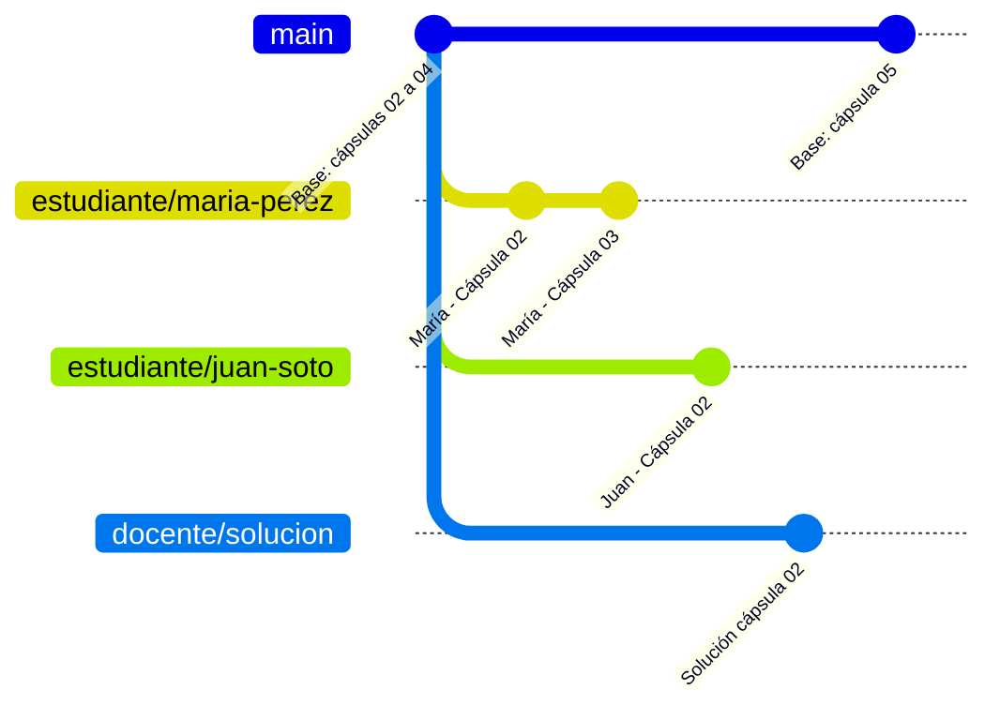
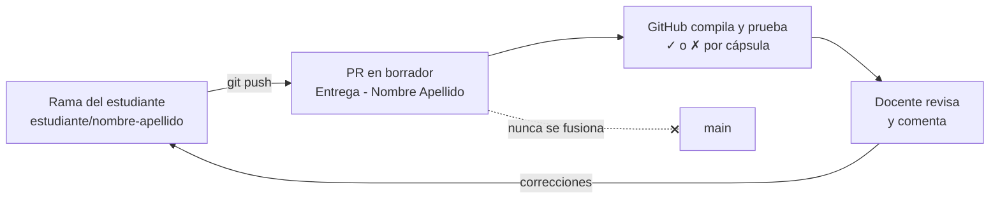

# C básico - Autómatas y Lenguajes Formales

Autómatas y Lenguajes Formales - Ingeniería Civil en Informática  
Universidad de Los Lagos  
Victor Saldivia Vera - victor.saldivia@ulagos.cl

Este repositorio acompaña las **cápsulas del lenguaje de programación en C** del curso. Aquí está el código base de cada cápsula, y aquí entregas tus actividades mediante un **Pull Request**.

## ¿Para qué sirve este repositorio?

1. **Practicar C** con la misma herramienta que usarás en asignaturas futuras: `gcc` en Linux (Ubuntu sobre WSL).
2. **Entregar las actividades** de cada cápsula en tu propia rama, donde el docente revisa y comenta.
3. **Aprender Git y GitHub**, la forma en que se trabaja con código en la industria.

Cada vez que subes tus cambios, GitHub **compila tu código automáticamente** con `-Wall -Wextra -Werror` y corre una prueba por cápsula. En tu Pull Request verás un ✓ o una ✗ al lado de cada cápsula.

---

## Antes de empezar

Sigue las guías en este orden. Cada una tiene su paso a paso.

| Paso | Guía | Qué logras |
|---|---|---|
| 1 | [Preparar el entorno de C](docs/01-entorno-c.md) | WSL + Ubuntu + gcc + VS Code funcionando |
| 2 | [Configurar Git y GitHub en Ubuntu](docs/02-git-y-github.md) | Git configurado y sesión iniciada con `gh` |
| 3 | [Flujo de trabajo del estudiante](docs/03-flujo-estudiante.md) | Clonar, crear tu rama, entregar con Pull Request |
| - | [Problemas frecuentes](docs/05-problemas-frecuentes.md) | Soluciones a los errores más comunes |

> **Regla a seguir:** todo se hace **dentro de Ubuntu** (la terminal de WSL o la terminal de VS Code conectada a «WSL: Ubuntu»). No uses PowerShell ni Git para Windows en este repositorio.

---

## Inicio rápido

Si ya completaste las guías 1 y 2:

```bash
cd ~
git clone https://github.com/Vikktor93/c-basico-automatas.git
cd c-basico-automatas
git checkout -b estudiante/nombre-apellido
code .
make
./build/capsula-02/hola
```

Debes ver `Hola, mundo`. Ahora sigue el [flujo del estudiante](docs/03-flujo-estudiante.md).

---

## Estructura del repositorio

```
c-basico-automatas/
├── README.md                       este archivo
├── Makefile                        compila todas las cápsulas en build/
├── .gitignore                      qué NO se sube (ejecutables, build/)
├── .gitattributes                  saltos de línea de Linux para todos
├── .github/
│   ├── pull_request_template.md    lista que completas al entregar
│   └── workflows/compilar.yml      compilación y pruebas automáticas
├── docs/
│   ├── 01-entorno-c.md             WSL, Ubuntu, gcc y VS Code
│   ├── 02-git-y-github.md          git y gh en Ubuntu
│   ├── 03-flujo-estudiante.md      paso a paso para entregar
│   ├── 04-flujo-docente.md         administración del repositorio
│   └── 05-problemas-frecuentes.md  errores comunes
├── capsula-02/                     Hola, mundo
│   ├── README.md                   enunciado de la actividad
│   ├── hola.c
│   └── prueba.sh                   prueba automática
├── capsula-03/                     Anatomía de un programa
│   ├── README.md
│   ├── ficha.c                     esqueleto con TODO
│   └── prueba.sh
├── capsula-04/                     C para quien ya programa
│    ├── README.md
│    ├── paridad.c                   esqueleto con TODO
│    ├── esperado.txt                salida que debe producir paridad
│    ├── respuesta.md                pregunta de reflexión
│    └── prueba.sh
├── ejemplos/                       programas de las cápsulas (no se evalúan)
```

Cada cápsula es una carpeta. Dentro, el `README.md` explica la actividad y `prueba.sh` la revisa.

---

## Compilar y probar

Desde la carpeta raíz del repositorio:

| Comando | Qué hace |
|---|---|
| `make` | Compila todas las cápsulas. Los ejecutables quedan en `build/` |
| `make DIR=capsula-04` | Compila solo una cápsula |
| `make estricto` | Compila como GitHub: las advertencias cuentan como errores |
| `make probar` | Compila y corre todas las pruebas |
| `make probar DIR=capsula-04` | Prueba solo una cápsula |
| `make clean` | Borra `build/` |

Ejemplo:

```bash
make DIR=capsula-04
./build/capsula-04/paridad
make probar DIR=capsula-04
```

> También puedes compilar a mano, como en las cápsulas: `gcc -Wall -Wextra -g paridad.c -o paridad`. El ejecutable que se crea dentro de la carpeta **no se sube** a GitHub: el `.gitignore` lo excluye.

---

## Diagrama de Flujo

**Las ramas:** todas nacen de `main`, y cada una avanza por separado.



**Cómo se entrega y se revisa:**



- **`main`** tiene el código base de las cápsulas. Está protegida: solo el docente puede modificarla.
- Cada estudiante trabaja **solo en su rama** `estudiante/nombre-apellido`.
- La entrega es **un único Pull Request en borrador** hacia `main`, que **nunca se fusiona**. Cada `git push` lo actualiza.
- La solución del docente está en `docente/solucion` y se publica cuando cierra el plazo de cada cápsula.

---

## Convenciones

| Elemento | Formato | Ejemplo |
|---|---|---|
| Rama del estudiante | `estudiante/nombre-apellido` (minúsculas, sin tildes ni ñ) | `estudiante/maria-perez` |
| Commit que cierra una actividad | `Cápsula NN: descripción breve` | `Cápsula 03: ficha con mis datos` |
| Commits intermedios | Verbo + qué cambió | `Agrega función es_par` |
| Título del Pull Request | `Entrega - Nombre Apellido` | `Entrega - María Pérez` |
| Rama del docente | `docente/solucion` | - |
| Etiqueta de solución | `capsula-NN` | `capsula-03` |

## Lo que NO se sube al repositorio

Ya está configurado en `.gitignore`:

- `build/`: los ejecutables de `make`. Se recrean con `make`.
- Ejecutables compilados a mano dentro de cada cápsula (`hola`, `ficha`, `paridad`, `a.out`).
- Archivos objeto `*.o`.
- `.vscode/`: la configuración personal de tu editor.

## Glosario rápido

| Término | Significado |
|---|---|
| **Repositorio** | La carpeta del proyecto con todo su historial de cambios. |
| **Clonar** | Descargar el repositorio de GitHub a tu computador (`git clone`). |
| **Rama** | Una línea de trabajo independiente. Lo que haces en tu rama no afecta a las demás. |
| **Commit** | Una «foto» guardada de tus cambios, con un mensaje que la describe. |
| **Push** | Subir tus commits a GitHub. |
| **Pull** | Traer los cambios de GitHub a tu computador y aplicarlos. |
| **Merge** | Unir los cambios de una rama en otra. |
| **Pull Request (PR)** | Solicitud en GitHub para revisar los cambios de una rama. Aquí la usamos como **entrega**. |
| **Borrador (Draft)** | PR marcado como «en progreso», que no se puede fusionar por accidente. |
| **Check** | Resultado de la compilación automática que aparece en tu PR: ✓ aprobado, ✗ con errores. |
